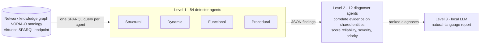

# MASynReas: Multi-Agent Synergistic Reasoning for Network Anomaly Diagnosis

MASynReas diagnoses anomalies in telecom and IT networks represented as knowledge graphs. Symbolic agents query the graph with SPARQL, detect elementary anomaly patterns and correlate them into ranked diagnoses; a local LLM only turns the final diagnosis into a readable report. Every conclusion can be traced back to the graph facts that support it.

Collective Scientific Project (PSC) at École Polytechnique in collaboration with **Orange Research**, 2025–2026.
Team: Andrea Signoretti, Paul Chiche, Raphaël des Boscs, Qile Liu.

## Architecture



- **Level 1, detection.** 54 agents, one anomaly pattern and one SPARQL query each, organized along the four facets of the [NORIA-O](https://github.com/Orange-OpenSource/noria-ontology) ontology: structural (resources, links, interfaces), dynamic (events, changes), functional (applications, services) and procedural (tickets, procedures).
- **Level 2, diagnosis.** 12 deterministic agents read selected level-1 outputs, check activation conditions, correlate evidence on shared entities, and output a diagnosis with reliability, severity and priority scores (e.g. single point of failure, change-induced incident, service cascade).
- **Level 3, narrative synthesis.** A local LLM (Ollama) writes the final report from the level-2 diagnoses: it explains the decision, it does not make it. In this repository, this layer is implemented and evaluated in the ablation study (`ablation_study.py`) rather than as an agent of the JaCaMo system.

The system runs in two modes:

| Mode | Purpose | Detectors | Diagnosers |
|---|---|:---:|:---:|
| `apriori` | Find structural weaknesses before any incident | 23 | 5 |
| `aposteriori` | Explain causes and propagation once incidents, events or tickets exist | 31 | 7 |

| Family | A priori detectors | A posteriori detectors |
|---|:---:|:---:|
| Structural | 10 | 7 |
| Dynamic | 3 | 12 |
| Functional | 7 | 9 |
| Procedural | 3 | 3 |

## Key results

Experiments on noria-0.2, Orange's reference network knowledge graph (3,152 triples). Details in [EXPERIMENTS.md](EXPERIMENTS.md).

**Correlating facts before the LLM makes its diagnoses reliable.** Ablation over 5 incident scenarios × 5 runs with `llama3.1:8b`:

| LLM input | Hallucination ↓ | Conformity to ground truth ↑ | Correct severity ↑ |
|---|:---:|:---:|:---:|
| Ticket text only | 0.00 | 0.60 | 100% |
| Raw level-1 findings | 0.05 | 0.53 | 60% |
| **Level-1 findings + level-2 diagnoses** | **0.00** | **0.87** | **100%** |

Raw, uncorrelated findings actually make the LLM *worse* than the ticket alone: it over-diagnoses severity on multi-signal incidents. Adding the level-2 correlation fixes this.

**The four agent families are complementary.** In a priori mode, each family detects entities that no other family sees, and the overlaps (e.g. applications flagged by both structural and functional detectors) are exactly what level 2 merges into a single diagnosis.

**Independent agents parallelize well.** Running all detectors sequentially takes 4.9 s (a priori) and 6.5 s (a posteriori), against under 0.4 s for the slowest single detector: a theoretical speedup of 12.6× and 18.7×.

## Benchmark catalogue

[`datasets/`](datasets/README.md) contains 27 synthetic scenarios (DS01–DS27) built from two reference graphs by controlled anomaly injection, data removal and noise. Each scenario comes with its graph (Turtle) and the expected level-1 and level-2 outputs. They cover clean controls, partial evidence (no diagnosis expected), each a priori and a posteriori diagnosis, robustness to missing and noisy data, ranking of several true diagnoses, score calibration and scalability.

## Repository structure

| Path | Content |
|---|---|
| [`multiagentSystem.jcm`](multiagentSystem.jcm) | JaCaMo entry point: agents and environment |
| [`mas.properties`](mas.properties) | Execution mode and Python interpreter |
| [`src/agt/`](src/agt) | Agents: one folder per family ([structural](src/agt/structural/README.md), [dynamic](src/agt/dynamic/README.md), [functional](src/agt/functional/README.md), [procedural](src/agt/procedural/README.md)) and [level 2](src/agt/level2/README.md). Each agent is a Jason `.asl` file plus a Python script holding its SPARQL query |
| [`src/env/env/PythonExecArtifact.java`](src/env/env/PythonExecArtifact.java) | CArtAgO artifact that runs the Python detectors from the agents |
| [`datasets/`](datasets/README.md) | Reference graphs and the 27-scenario benchmark |
| `results/` | JSON outputs of the last run (one file per agent) |
| `run_all_detectors.py`, `complementarity_table.py`, `ablation_study.py`, `baseline_monoagent.py` | Experiment scripts, documented in [EXPERIMENTS.md](EXPERIMENTS.md) |

## Getting started

### Requirements

- Java 11+ and the [JaCaMo](https://jacamo-lang.github.io/) CLI in your `PATH`
- Python 3.8+ with `pip install -r requirements.txt`
- [OpenLink Virtuoso](https://vos.openlinksw.com/owiki/wiki/VOS) running on `http://localhost:8890/sparql`, with a NORIA-O graph loaded (noria-0.2, or any `dataset.ttl` from `datasets/`)
- For the ablation study only: [Ollama](https://ollama.com/) with `llama3.1:8b`

### Run the multi-agent system

Choose the mode in `mas.properties`:

```properties
mode=apriori        # or aposteriori
python.path=        # empty = use python/python3 from PATH
```

Then, from the project root:

```bash
jacamo multiagentSystem.jcm
```

The selected mode activates its level-1 detectors, which write their findings to `results/<family>/<mode>/`. Once all of them have finished, `level2_controller` launches the diagnosers of the same mode, which write to `results/level2/<mode>/`.

### Run the experiments

```bash
python -X utf8 run_all_detectors.py both
python -X utf8 complementarity_table.py
python -X utf8 ablation_study.py
```

(`-X utf8` is only needed on Windows.)
